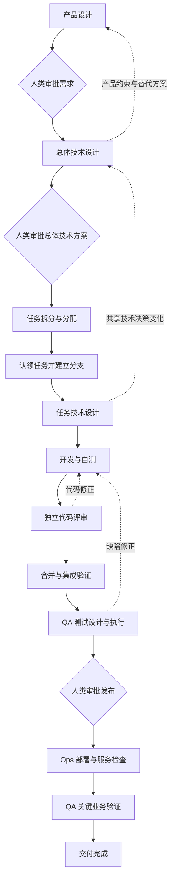

# Scrum

Scrum 是一组面向多 Agent 产品团队的 Skills，用明确的输入、输出和责任边界，组织从产品需求到交付的协作。

人类负责人提出目标，并审批需求、总体技术方案和发布决定。Project Manager 协调交接、依赖和反馈；产品、工程、独立代码评审、QA 和 Ops 各自负责专业结论。项目希望减少人工重建上下文和推动交接的工作，这一收益尚未通过真实项目验证。

## 当前范围

仓库目前包含 **7 个职能 Skill 和 3 个工具 Skill** 的说明及配套资源。完整设计还包括 `test-design`、`test-execution` 和 `deployment`，这三个 Skill 尚未加入仓库。

当前设计文档为 **v3 / IN_REVIEW / Approval Pending**。已有 Skill 文件不代表整套流程已经通过实际运行验证。本项目提供工作方法与交接约定；Agent 配置、任务认领、运行调度和平台操作需要由使用环境提供。

## Skills

Skill 按职能划分，角色表示责任归属。一个角色可以使用多个 Skill，多个开发 Agent 也可以共用同一个开发 Skill。

| Skill | 负责角色 | 主要工作与输出 |
| --- | --- | --- |
| [product-design](product-design/SKILL.md) | Product Manager（PM，产品经理） | 澄清价值、范围和行为，产出含规则、验收示例及未决问题的产品设计文档 |
| [technical-design](technical-design/SKILL.md) | 架构负责人 / 开发者 | `overall` 模式确定总体架构与共享契约；`task` 模式细化单个已认领任务的实现与验证方案 |
| [planner](planner/SKILL.md) | 工程负责人 | 将已批准的设计拆成可评审任务，明确验收、依赖、负责人和 Git 基线，输出计划索引及独立任务文件 |
| [code-development](code-development/SKILL.md) | 开发者 | 根据就绪的任务设计实现、自测，交付聚焦的任务 PR 和实际验证证据 |
| [code-review](code-review/SKILL.md) | 独立 Code Reviewer | 使用 `open-code-review`（`ocr`）并核实结果，输出评审覆盖、发现及明确结论 |
| [code-integration](code-integration/SKILL.md) | 工程负责人 | 检查评审、必需检查和依赖，合并符合条件的 PR，验证并交付候选版本 |
| [project-manager](project-manager/SKILL.md) | Project Manager（项目经理） | 协调交接、审批、阻塞和反馈，根据专业产物与证据记录交付状态 |

架构职责可由工程负责人兼任。PM 在本项目中专指 Product Manager，与 Project Manager 区分。

三个工具 Skill 为各职能提供共用方法：

| Skill | 用途 |
| --- | --- |
| [technical-writing](technical-writing/SKILL.md) | 按读者需要组织文档，使表达清晰、精炼，并保留决策、条件和证据边界 |
| [document-review](document-review/SKILL.md) | 按指定契约、模板和证据审阅文档，报告检查范围、发现和验证限制 |
| [git-workflow](git-workflow/SKILL.md) | 处理任务分支、限定范围的提交、评审差异、PR 准备和已授权的 Git 集成操作 |

各业务流程输出文档、报告、反馈或交接摘要时，必须使用 `technical-writing` 作为写作方法，并在交付前使用 `document-review` 检查内容、格式和证据。Git 流程的操作报告和 PR 描述同样适用。各流程保留必需内容、领域标准、独立审阅、状态和审批规则；文档审阅不替代代码评审、执行验证或审批。

`document-review` 的审阅报告也使用 `technical-writing` 撰写，并在本次调用内按自身报告规则复核。复核不递归调用 Skill，也不额外生成一份审阅报告。`technical-writing` 保持通用写作能力，由调用流程安排文档审阅。

后续设计中的职能：

| Skill | 负责角色 | 预期输出 |
| --- | --- | --- |
| `test-design` | QA | 与验收条件关联的测试计划、用例及部署后的关键业务检查 |
| `test-execution` | QA | 指定版本和环境的实际测试结果、缺陷、未执行项及验收结论 |
| `deployment` | Ops | 部署版本、目标环境、服务检查证据，以及失败时的恢复结果或待决事项 |

## 协作流程

下图展示设计中的完整交付流程。QA 和部署阶段仍需补齐对应 Skill。



Project Manager 贯穿各阶段，检查输入版本与就绪条件，再将工作交给对应角色。图中省略了部分反馈路径；实际交接规则见 [handoff-flow](project-manager/references/handoff-flow.md)。

- **三个人类审批点：** 需求、总体技术方案、发布决定。审批绑定具体版本；发布审批还绑定候选版本、目标环境和保留问题。
- **两层技术设计：** 总体设计先解决可行性、共享接口和影响任务边界的决策；任务设计在认领和建立分支后完成，细化局部实现。批准范围内的日常细化无需新增人类审批。
- **一个任务对应一个分支和一个 PR：** 任务应包含一个完整、可验证的变化，以及相关测试和文档。评审范围结合复杂度、风险和上下文判断，没有固定行数门槛。
- **独立评审后再集成：** 自测和自评不能代替独立代码评审。评审结论与必需检查必须适用于当前 PR 版本及相关基线。
- **发现约束可以返回上游：** 产品行为问题返回产品设计，共享架构问题返回总体技术设计，拆分问题返回 planner。基线变化后，重新评估受影响的任务与证据。
- **交付以验证结果为准：** 阻塞问题必须修复，保留的非阻塞问题在发布审批时由负责人确认。部署成功、Ops 服务检查通过、QA 关键业务检查通过，且证据对应同一部署版本与目标环境，才算交付完成。

## 如何使用

可以从当前需要的职能开始，也可以由 Project Manager 协调整个已授权流程。每个 Skill 的 `SKILL.md` 是入口，具体规则、模板和方法位于它引用的文件中。

1. 让 Agent 能够读取所需 Skill 及其引用资源。若复制到自己的 Skill 环境，保留各目录的同级关系，确保跨 Skill 相对链接有效。
2. 提供目标项目的上下文：当前目标或任务、设计文件及确切版本、已有审批、代码约定、依赖和已有工作状态。产品探索可以从一个目标开始，逐步澄清缺失信息。
3. 明确本次使用的职能和范围。技术设计需区分 `overall` 与 `task` 模式；后续阶段先核对输入、权限与就绪条件。
4. 接收专业产物和交接摘要，再进入下一阶段。需要任务平台、Agent 调度、PR 发布或部署能力时，使用环境中已授权的工具或平台 Skill。

以下是请求示例；将尖括号中的内容替换为实际上下文。

**从目标开始产品设计：**

```text
请按 product-design/SKILL.md，为 <项目> 梳理 <目标> 的价值、范围和行为，
通过具体例子澄清验收条件，并产出产品设计文档。
```

**基于已批准需求开展总体设计：**

```text
请按 technical-design/SKILL.md 的 overall 模式，基于 <产品文档路径及版本>
和 <对应审批记录>，评估可行性并设计总体架构、共享契约与验证策略。
发现影响产品方案的约束时，给出证据、替代方案和需要决定的问题。
```

**恢复已有交付：**

```text
请按 project-manager/SKILL.md，读取 <变更目录> 和 <当前交付记录>，
核对已有产物、审批、任务归属、分支及 PR，确定下一步和负责角色，
在既有授权范围内协调推进，并列出阻塞项和需要我决定的事项。
```

代码评审阶段需要可用且已配置的 `ocr` CLI，具体要求见 [OCR 使用说明](code-review/references/open-code-review.md)。缺少工具或访问能力时，应保留已完成的产物并报告缺口；未执行的检查不能记为通过。

## 产物与交接

每项产品变更在目标项目的 `doc/` 下保留一个稳定目录。计划索引连接各独立任务文件，开发 Agent 从自己的 `task.md` 进入工作。

```text
doc/YYYY-MM-DD-change-slug/
├── product-design.md          # 产品需求
├── technical-design.md        # 总体技术设计
├── task-plan.md               # 计划索引与依赖概览
├── tasks/
│   └── t1/
│       ├── task.md            # 任务定义与 Agent 入口
│       └── technical-design.md # 认领、建立分支后产出的任务设计
├── qa.md                      # QA 计划、结果与缺陷
└── history/
    └── product-design/
        └── v1.md              # 修订前保留的历史版本
```

文件随阶段产出，不预先创建空文档。任务路径保持稳定；任务文件记录认领证据，实际的独占认领由运行环境或平台保障。详细规则见 [产物目录约定](product-design/references/artifact-layout.md)。

每次职能交接都包含：

- 任务标识、输入文档及版本。
- 输出产物及引用。
- 当前结论、实际验证结果与证据。
- 未解决的问题、阻塞和验证缺口。
- 下一职能及负责接收者。

即使前后两个职能由同一角色承担，也保留各自的交接摘要。阶段完成、下游验收和人类批准分别记录。

## 设计来源

本 README 根据本地设计文档 `doc/2026-10-12-ai-product-team-skills/product-design.md`（v3，2026-10-12）及当前 Skill 文件整理。该设计仍待整体审批，完整团队协作尚未进行真实项目试运行。

本仓库的 `.gitignore` 当前排除了 `doc/`，因此克隆仓库不会自动获得上述本地设计文档。日常使用请从各 [Skill 入口](#skills) 及其配套规则、模板开始。
